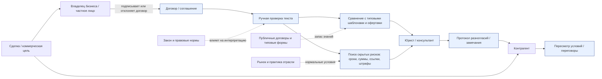

# Лабораторная работа 1. Границы и цель системы

## Тема: AI Legal Lens

Система, стоящая за темой, — это текущий порядок работы, в котором владелец малого бизнеса или частное лицо получает договор по электронной почте или на встрече с контрагентом, открывает его на ноутбуке в офисе, сверяет формулировки с типовыми шаблонами и офертами, выделяет спорные пункты, спрашивает совета у юриста и затем готовит протокол разногласий, чтобы не подписать условия, которые сэкономят время на согласовании, но увеличат финансовый риск. Эта система существует в реальном рабочем контексте: в кабинете руководителя, в переписке с поставщиком и в коротком звонке с юристом, где решение принимается до подписания, а не после.

## Контекстная диаграмма

## Граница системы

### Внутри системы
- чтение и анализ текста договора;
- выделение потенциально рискованных условий;
- сравнение с типовыми формулировками и обычной практикой рынка;
- консультация с юристом или внутренним экспертом;
- формирование протокола разногласий и переговоры с контрагентом.

### Вне системы, но влияет на неё (среда)
- закон и действующие нормы;
- публичные шаблоны договоров и оферты компаний;
- отраслевые практики и типичные условия сделки;
- коммерческая цель контрагента и собственная цель клиента.

### Ни при чём
- общие новости и случайные события, не связанные с договором;
- внутренние корпоративные процессы, не связанные с сделкой;
- технические сервисы, не используемые в принятии решения по контракту.

### Спорные элементы и решение
- AI-модель: в текущем виде, без продукта, её нет; это не часть существующей системы, потому что задача решается человеком с опорой на шаблоны, опыт и юрисконсультацию.
- Контрагент: он не внутри системы как «исполнитель», но его действия напрямую влияют на переговоры и интерпретацию риска.
- Нормативные ссылки и приложения: это часть договора, но их анализ делается только через контекст и допдокументы, поэтому они рассматриваются как часть системы, а не как внешние шумы.

## Заинтересованные стороны и их цели

| Заинтересованная сторона | Цель | Конфликт с другими сторонами |
|---|---|---|
| Владелец малого бизнеса / частное лицо | Подписать договор без скрытых обязательств и не потерять деньги | Согласовать условия выгодно для себя; не хочет оплачивать лишние риски |
| Контрагент / поставщик / покупатель | Закрепить условия сделки в свою пользу и снизить собственные потери | Может стремиться к менее выгодным для клиента формулировкам |
| Юрист / консультант | Найти реальные юридические риски и минимизировать вероятность ошибки | Может считать риск «нормальной практикой», а клиент — слишком высоким |
| Законодательство и суд | Зафиксировать справедливые и понятные правила обмена | Не всегда напрямую учитывает коммерческую выгоду сторон |
| Публичные шаблоны и типовые договоры | Предоставить ориентиры и стандарты | Не всегда подходят к конкретной сделке и могут поддерживать типовую невыгодную практику |

## Цель системы

Цель системы — помогать стороне сделки вовремя увидеть, какие пункты договора являются реальным юридическим риском, а какие — обычной коммерческой практикой; затем сформулировать замечания и перевести переговоры в конструктивный процесс до подписания.

Достижение цели видно по следующим признакам:
- в договоре обнаруживаются скрытые обязательства, штрафы, неясные сроки и ссылки на приложения;
- владелец может объяснить, почему пункт опасен, без глубоких юридических знаний;
- формируется протокол разногласий, который отправляется контрагенту до подписания;
- переговоры переносятся из «читать по диагонали» в обсуждение конкретных рисков.

## Три наблюдения из похода в систему

1. В офисе собственника, когда договор за подпись приходит по почте, самый опасный пункт часто оказывается не «сверхжестким», а оформленным нейтрально: например, формулировка «при задержке оплаты поставщик вправе приостановить поставки и начислить штраф 0,1% от суммы просрочки в день» выглядит как стандартная оговорка, но в момент переговоров превращается в реальный механизм давления на оборотный капитал. Это удивило, потому что риск не всегда читается по громким словам, а скрывается в привычной, технической формулировке.
2. На звонке с юристом и в переписке с контрагентом решение редко строится на чистом праве: человек сначала сверяет формулировку с типовым договором поставщика, спрашивает «у вас так обычно?» и только потом обсуждает, что это безопасно или нет. Это удивило, потому что в реальности нормальность определяется не только законом, но и тем, какие условия уже приняты в отрасли и каких формулировок придерживается контрагент.
3. В конце переговоров результат становится понятен не по самому анализу, а по тому, что происходит потом: после списка замечаний контрагент не спорит по каждому пункту, а меняет только три условия — отсрочку оплаты, лимит штрафа и порядок уведомлений. Это удивило, потому что юридическая работа в системе заканчивается не чтением договора, а изменением реального текста, который реально пойдёт в сделку.

## Краткий вывод

Система существует, чтобы превратить договор из «документа на подпись» в предмет переговоров, где риск виден заранее. Её ценность состоит в том, что она уменьшают асимметрию знаний между бизнесом и контрагентом и переводит принятие решения из «надеюсь» в «проверено».
