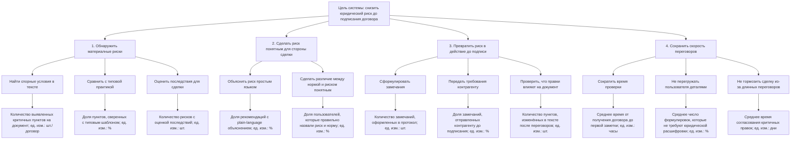

# Лабораторная работа 2. Структура и дерево целей

## Тема: AI Legal Lens

Система, стоящая за темой, — это не продукт, а текущий способ проверки договора до подписания: владелец бизнеса или частное лицо получает договор, выделяет спорные условия, сверяет их с типовыми формулировками и офертами, обращается к юристу, а затем переводит замечания в протокол разногласий и переговоры с контрагентом. Система нужна для того, чтобы снизить реальный юридический риск и не дать стандартной формулировке превратиться в финансовую и управленческую проблему после подписания.

## 1) Декомпозиция по функциям

В этой декомпозиции система видна как цепочка действий, которые последовательно приводят к решению о подписи или отказе.

1. Приём и структурирование входа
   - получить документ из почты, чата или встречи;
   - определить тип документа и контекст сделки;
   - зафиксировать ключевые параметры: сумма, срок, ответственность, порядок оплаты.
2. Поиск и выделение рисков
   - идентифицировать спорные пункты, штрафы, отсрочки, лимиты ответственности;
   - сравнить с типовыми шаблонами, типовыми офертами и отраслевыми практиками;
   - понять, где формулировка выглядит нейтрально, но меняет экономику сделки.
3. Проверка и интерпретация
   - отнести риск к типу: нормальная практика, спорный пункт, критический риск;
   - проверить, есть ли юридическая норма или типовая практика, которая оправдывает формулировку;
   - определить, кто несёт риск в случае нарушения.
4. Консультация и принятие решения
   - получить мнение юриста или эксперта;
   - сформулировать вопрос: что критично, что можно договориться, что можно игнорировать;
   - выбрать стратегию: согласовать, изменить, отказаться от сделки.
5. Переговорный выход
   - оформить замечания, протокол разногласий, правки и комментарии;
   - отправить их контрагенту и обсуждать до подписания.

Что видно в этой декомпозиции: процесс и точки принятия решений. Что не видно: кто именно участвует, какая роль у шаблонов и как устроена база знаний; это не показывает, как знания и договорный язык распределены между участниками.

## 2) Декомпозиция по составу системы

В этой декомпозиции система видна как набор элементов, которые создают основу для решения задачи и влияют на качество итогового решения.

1. Документ как объект решения
   - сам договор, приложение, оферта, допсоглашение;
   - текст, ссылки, оговорки, сроки, суммы, штрафы.
2. Сравнительный слой
   - типовые договоры, публичные формы, оферты компаний;
   - отраслевые договорённости и устоявшаяся практика;
   - шаблоны, с которыми сравнивают текущий документ.
3. Человеческий слой
   - владелец бизнеса или частное лицо принимает решение;
   - юрист оценивает реальный риск и допустимость условий;
   - контрагент формирует своё представление о нормальности условий.
4. Коммуникационный слой
   - переписка по email, мессенджеры, совещания, звонки;
   - формирование списка замечаний и протокола разногласий;
   - обсуждение уже после первого чтения договора.
5. Контекст сделки
   - цель сделки, условия рынка, временные ограничения, коммерческая срочность;
   - то, что делает договор выгодным в момент согласования, но опасным в момент исполнения.

Что видно в этой декомпозиции: состав и источник знаний. Что не видно: логика принятия решения и как именно элементы взаимодействуют по времени; она хуже показывает последовательность действий.

### Сравнение двух декомпозиций

Первая декомпозиция лучше описывает процесс принятия решений и то, где именно в работе возникает риск. Вторая лучше показывает, на чём держится система: из чего состоит договор, кто в ней участвует и какие знания используются для сравнения. Вместе они дополняют друг друга: по функциям видно движение от документа к решению, а по составу — реальные ресурсы и силы, которые это движение обеспечивают.

## Дерево целей

### Показатели по листьям и откуда их брать

- количество выявленных критичных пунктов на документ: берётся из чек-листа юриста или из итогового списка рисков после проверки договора; единица измерения — штуки на договор;
- доля пунктов, сверенных с типовым шаблоном: считается как число пунктов, которые сравнивались с публичными шаблонами, делённое на общее число спорных пунктов; единица — проценты;
- количество рисков с оценкой последствий: берётся из списка замечаний, где риск привязан к финансовому, сроковому или операционному эффекту; единица — штуки;
- доля рекомендаций с plain-language объяснением: считается по количеству пояснений, которые понятны владельцу без юридического образования; единица — проценты;
- доля пользователей, которые правильно назвали риск и норму: берётся после короткого опроса или проверки решения; единица — проценты;
- количество замечаний, оформленных в протокол: фиксируется в документе разногласий; единица — штуки;
- доля замечаний, отправленных контрагенту до подписания: рассчитывается как число замечаний до подписи к общему числу замечаний; единица — проценты;
- количество пунктов, изменённых в тексте после переговоров: берётся из версии договора после согласования; единица — штуки;
- среднее время от получения договора до первой заметки: измеряется от момента загрузки файла до формирования первого списка замечаний; единица — часы;
- среднее число формулировок, не требующих юридической расшифровки: берётся по категориям условий, которые можно понять по смыслу без внешнего консультанта; единица — проценты;
- среднее время согласования критичных правок: измеряется по блокам согласования между собственником и контрагентом; единица — дни.

## Конфликт целей

Основной конфликт целей в этой системе — между качеством юридической защиты и скоростью сделки. Ветви «обнаружить материалные риски» и «сохранить скорость переговоров» часто расходятся: чем глубже проверка и чем больше замечаний, тем сильнее риск задержки и усложнения сделки. Для владельца бизнеса эта задача обычно решается так: сначала фиксируются только критичные, действительно материальные риски, а технические или спорные пункты отдают на доработку в ходе переговоров. Сегодня этот спор решают собственник и юрист: они отбирают то, что влияет на бизнес-эффект, а не всё, что формально выглядит опасным. В реальной работе именно эта фильтрация и определяет, что будет считаться серьёзным риском, а что — нормальной практикой.

## Какая ветка дерева сейчас проседает

Наиболее проседающая ветка — «сделать риск понятным для стороны сделки и превратить его в действие» (ветви C и D). Это видно по текущей системе, потому что в теме есть прямой признак этого слабого звена: задача явно формулируется как вопрос о том, «что считать риском для этой стороны сделки, а что нормальной практикой», «как показать риск, чтобы человек без юридического образования понял» и «где появляется результат — протокол разногласий».

Иначе говоря, система умеет выделять формулировки и находить риск, но у неё есть слабое место в переводе этих замечаний в понятное решение для человека и в действие по изменению договора. По сути, несколько веток дерева построены на риске как на анализе, а не на реальном результате в переговорах: это показывает, что до момента согласования контрагентом и собственником риск может быть обнаружен, но не всегда превращён в управляемое действие.
